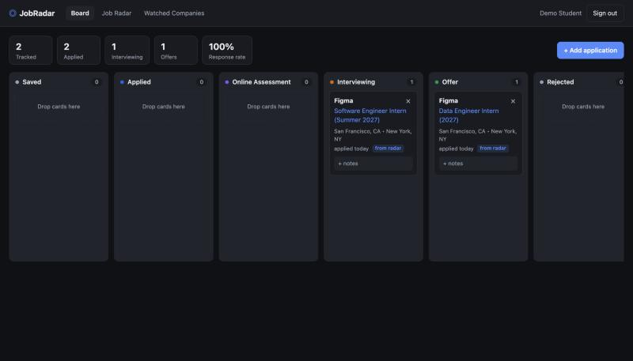
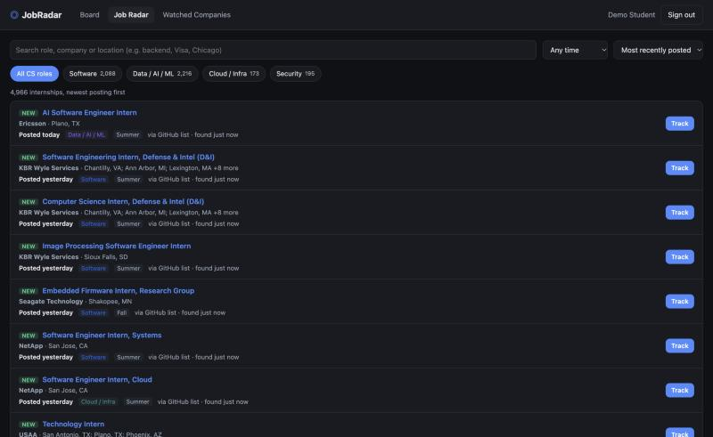
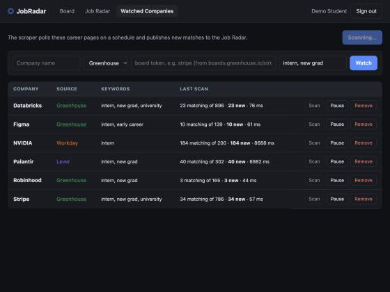
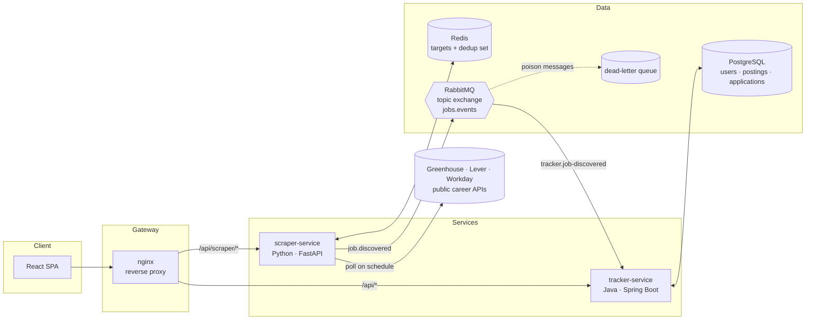

# JobRadar

**An event-driven job-tracking platform that finds new computer-science internships across 1,500+ companies, from big tech to small startups, and manages your whole application pipeline on a Kanban board.**

CS students apply to hundreds of internships and track them in messy spreadsheets. Postings on Greenhouse, Lever, Workday, and Ashby often go up with no announcement, and early applicants get the advantage. JobRadar polls company career pages and community-maintained GitHub internship lists, keeps only CS roles (software, data/AI/ML, cloud/infra, security), and shows them newest-posted first. You can then move each application from *Saved* to *Offer* on one board.



| Job Radar feed | Watched companies |
|---|---|
|  |  |

---

## Architecture



Each service owns its data and can be deployed, scaled, and failed independently:

| Service | Stack | Responsibility |
|---|---|---|
| **scraper-service** | Python 3.12, FastAPI, httpx (async), aio-pika, Redis | Polls 5 source types concurrently (Greenhouse, Lever, Workday, Ashby, and GitHub internship lists), classifies CS roles, dedupes, and publishes `job.discovered` events |
| **tracker-service** | Java 21, Spring Boot 3.5, Spring Security, Spring Data JPA, Spring AMQP, Flyway | Issues JWTs, consumes events into PostgreSQL, serves the jobs feed and the Kanban/application REST API |
| **frontend** | React 18, TypeScript, Vite, nginx | Kanban board with drag-and-drop, live job feed, and target management. nginx doubles as the API gateway |
| **infra** | Docker Compose, PostgreSQL 16, RabbitMQ 3.13, Redis 7 | Health-checked startup ordering, persistent volumes |

### How a stealth job drop reaches your board

1. The **scraper** sweeps every enabled target on a schedule (default: 15 min), with up to 4 targets in flight at once.
2. Postings are normalized and filtered to internships: whole-word title keywords (`intern` matches "Interns" but not "Internal Tools"), or the source's own internship flag. A title classifier then tags each posting as **Software**, **Data / AI / ML**, **Cloud / Infra**, or **Security**, and drops non-CS roles (sales, mechanical, product management, and so on).
3. Each match is added to a Redis set with `SADD`. Only postings never seen before are published, so a posting is announced exactly once, even with multiple scraper replicas.
4. The event goes to the durable topic exchange `jobs.events` as a persistent message, with publisher confirms and `mandatory` routing. If no consumer queue is bound yet, the publish fails, the dedup mark is rolled back, and the posting is retried on the next sweep. Nothing is silently dropped.
5. The **tracker** consumes from its own queue. Inserts are idempotent through a `(source, company, external_id)` unique constraint, so redelivered or duplicate events are harmless. Invalid events are retried 3 times with exponential backoff, then dead-lettered for inspection.
6. The posting appears in the **Job Radar** feed with a `NEW` badge. **Track** turns it into a Kanban card.

### Design decisions

- **Asynchronous messaging instead of REST between services.** The scraper never calls the tracker. If the tracker is down, events wait in a durable queue, and new consumers (say, an email-alert service) can subscribe to `jobs.events` without touching the scraper.
- **Stateless JWT auth across languages.** The tracker issues HS256 tokens with Spring Security's OAuth2 resource-server support. The Python scraper validates the same token with a shared key, so there are no session lookups or service-to-service auth calls. Each service authorizes requests on its own.
- **Reaching startups through GitHub lists.** Small companies rarely have a watchable ATS board, but community lists like [SimplifyJobs/Summer2027-Internships](https://github.com/SimplifyJobs/Summer2027-Internships) track thousands of them and publish a machine-readable `listings.json`. A `github_list` adapter reads any list in that format, using HTTP ETags so an unchanged 13 MB list costs one `304`.
- **Cross-source dedup.** The same role often appears on its company's ATS *and* on several GitHub lists. The tracker collapses duplicates by canonical URL (tracking params stripped) and by a normalized `company|title` fingerprint over a 60-day window, so each role appears once.
- **Sorting by real posting dates.** Every adapter maps the source's own publish date (Greenhouse `first_published`, Lever `createdAt`, Ashby `publishedAt`, the list's `date_posted`, and Workday's "Posted N days ago"). The feed sorts by it, newest first, and can filter to the last 24 hours, 3 days, week, or month.
- **Using the ATS JSON APIs instead of parsing HTML.** Greenhouse and Lever expose public job-board APIs. Workday pages are client-rendered, but the page itself loads its data from a JSON endpoint (`/wday/cxs/{tenant}/{site}/jobs`), which the adapter paginates. Each ATS is one small adapter behind a common `JobSource` protocol, so adding a new one is about 40 lines.
- **Failure isolation.** One broken career page records an error for that target and never stops the sweep for the others.
- **Per-user data isolation.** Every application query is scoped by the JWT's user id, so another user's card id returns `404`, not `403`. That avoids leaking which ids exist.
- **Dense Kanban ordering.** Moves renumber the affected columns transactionally. The frontend applies the same algorithm optimistically, so drag-and-drop doesn't flicker while the request is in flight.

---

## Running it

**Requirements:** Docker Desktop (or any Docker Engine with Compose v2).

```bash
cp .env.example .env          # optional: set your own JWT secret / passwords
docker compose up -d --build --wait
open http://localhost:3000    # create an account, then open "Job Radar"
```

The scraper runs its first sweep on startup. Within a minute the feed fills with about 4,500 live CS internships from the sources in [`scraper-service/targets.json`](scraper-service/targets.json). Add any Greenhouse, Lever, Workday, or Ashby company, or another GitHub list, from the **Watched Companies** tab.

| URL | What |
|---|---|
| http://localhost:3000 | App (via nginx gateway) |
| http://localhost:3000/api/docs | Swagger UI for tracker-service |
| http://localhost:15672 | RabbitMQ management UI (`jobradar` / `jobradar`) |

To run the full end-to-end check against the running stack:

```bash
bash scripts/smoke-test.sh
```

### Local development without Docker

```bash
# scraper-service (in-memory store and publisher when REDIS_URL / RABBITMQ_URL are unset)
cd scraper-service && python3.12 -m venv .venv && .venv/bin/pip install -r requirements-dev.txt
.venv/bin/uvicorn app.main:app --reload --port 8000

# tracker-service (needs PostgreSQL + RabbitMQ; see application.yml for env vars)
cd tracker-service && ./mvnw spring-boot:run

# frontend (Vite proxies /api to the two services)
cd frontend && npm install && npm run dev
```

---

## API overview

**tracker-service** (`/api`, Bearer JWT except auth)

| Method | Path | |
|---|---|---|
| POST | `/auth/register`, `/auth/login` | Returns a JWT |
| GET | `/auth/me` | Current user |
| GET | `/jobs?q=&category=&postedWithinDays=&sort=posted\|discovered&page=&size=` | Paginated feed, newest posting first by default, with a `tracked` flag per user |
| GET | `/jobs/categories`, `/jobs/companies` | Posting counts per role category and per company |
| GET / POST | `/applications` | Board / track a job (`jobId`) or add a manual card |
| PATCH | `/applications/{id}` | Edit notes and details |
| PUT | `/applications/{id}/move` | Drag-and-drop `{status, position}` |
| DELETE | `/applications/{id}` | Remove a card |
| GET | `/applications/stats` | Funnel counts per status |

**scraper-service** (`/api/scraper`, Bearer JWT)

| Method | Path | |
|---|---|---|
| GET / POST | `/targets` | List / watch a company |
| PUT / DELETE | `/targets/{id}` | Edit / stop watching |
| POST | `/scrape`, `/targets/{id}/scrape` | Trigger a sweep now |
| GET | `/scrape/last` | Last sweep report |

Both services expose health checks and Prometheus metrics: `/health` and `/metrics` on the scraper, and `/actuator/health` and `/actuator/prometheus` on the tracker.

---

## Testing and CI/CD

| Suite | What it covers |
|---|---|
| `scraper-service` pytest (55 tests) | All 5 source adapters, CS role classification, GitHub-list ETag caching, seeding of new default sources, keyword matching, dedup across sweeps, per-target failure isolation, publish-failure rollback, JWT enforcement, and an HTTP-mocked sweep through the API |
| `tracker-service` JUnit + MockMvc (H2) | Register/login, validation errors, ingest idempotency, cross-source dedup, sorting and filtering the feed by posting date, category, and recency, the full Kanban flow (track, move, reorder, delete, stats), and cross-user isolation |
| `tracker-service` Testcontainers | Real PostgreSQL + RabbitMQ: raw JSON published the way the Python scraper sends it is persisted once, poison messages land in the DLQ, and the feed queries run on Postgres |
| `frontend` Vitest | Board grouping, the optimistic move algorithm, and posted-date labels |
| `scripts/smoke-test.sh` | Full stack through the nginx gateway: auth, cross-service JWT, live scrape, event ingestion, and the Kanban move |

The GitHub Actions pipeline ([`.github/workflows/ci-cd.yml`](.github/workflows/ci-cd.yml)) runs on every push and PR:

1. **Test** all three services in parallel: lint, type-check, unit and integration tests, and JaCoCo coverage.
2. **E2E:** `docker compose up --wait`, then the smoke test against the real containers.
3. **Publish** (on `main`): build and push versioned images (`:sha` and `:latest`) to GitHub Container Registry, with layer caching.
4. **Deploy** (opt-in): set the `DEPLOY_HOST` variable plus the `DEPLOY_SSH_KEY` and `DEPLOY_USER` secrets, and the pipeline rolls the new images out to any Docker host (for example an AWS EC2 or Azure VM) behind a `staging` environment gate.

---

## Ethics and rate limits

JobRadar only reads **public** job-board endpoints that the career pages themselves use, plus public GitHub repositories. It deliberately does **not** scrape LinkedIn or Handshake: both forbid automated collection in their terms, and Handshake sits behind university sign-in. Many of their internship postings still reach JobRadar through the GitHub lists, which link to the original company application pages. It sends an identifying User-Agent, polls on a conservative schedule (15 min by default), and caps per-sweep pagination. Please keep it that way.
